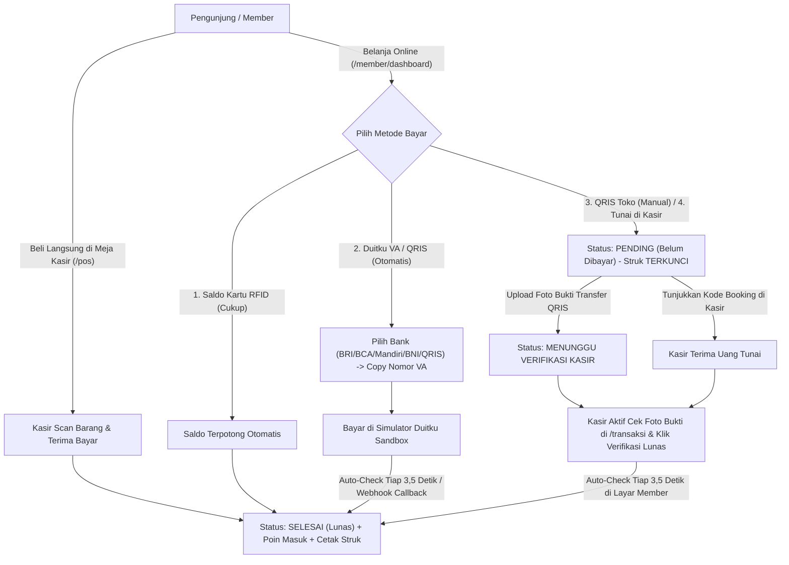

<div align="center">

# YAZID ELEKTRONIK (`tokoku`)
### Sistem Informasi POS Ritel, Member RFID, Duitku Payment Gateway, QRIS & Back-Office


-10B981?style=for-the-badge)

**Aplikasi Point of Sale (POS) Minimarket, Katalog Belanja Mandiri Member (*Hybrid Retail & Self-Order*), Manajemen Inventori, Kartu Loyalitas RFID, Integrasi Payment Gateway Duitku (Virtual Account & QRIS) + GoPay Merchant QRIS dengan Auto-Check Real-Time, dan Cetak Struk Thermal 1-Klik (`EPSON TM-T82X Receipt`)** yang dibangun dengan standar arsitektur bersih **`/yz-1`**.

*Terakhir diperbarui: **26 November 2026 (`2026-11-26`)***

</div>

---

## Daftar Isi

- [1. Sorotan Fitur Utama](#1-sorotan-fitur-utama)
- [2. Alur Pembelian Hybrid, Duitku Sandbox, QRIS Manual & Auto-Check Real-Time](#2-alur-pembelian-hybrid-duitku-sandbox-qris-manual--auto-check-real-time)
- [3. Matriks Hak Akses 4 Role (RBAC)](#3-matriks-hak-akses-4-role-rbac)
- [4. Integrasi Hardware & Payment Gateway (Duitku + GoPay Merchant + Auto-Detect Bank NNS)](#4-integrasi-hardware--payment-gateway-duitku--gopay-merchant--auto-detect-bank-nns)
- [5. Arsitektur Clean Code (`/yz-1`) & Database SQL Lanjut](#5-arsitektur-clean-code-yz-1--database-sql-lanjut)
- [6. Sistem Desain UI Ganda](#6-sistem-desain-ui-ganda)
- [7. Panduan Instalasi & Konfigurasi](#7-panduan-instalasi--konfigurasi)
- [8. Daftar Akun Demo & Kartu RFID (`DatabaseSeeder`)](#8-daftar-akun-demo--kartu-rfid-databaseseeder)
- [9. Pengujian Otomatis (`Pest`) & Formatter (`Pint`)](#9-pengujian-otomatis-pest--formatter-pint)
- [10. Catatan Pembaruan (Changelog — 26 November 2026)](#10-catatan-pembaruan-changelog--26-november-2026)

---

## 1. Sorotan Fitur Utama

### A. Layar Kasir POS Minimarket (`100vh` Tanpa Scrollbar)
- **Tampilan Kasir Ritel Profesional:** Seluruh area kerja (Header, Input Scan PLU/Barcode, Tabel Keranjang, Preview Produk, Panel Member RFID, Diskon/Poin, Pilihan Metode Bayar, hingga tombol `[F4] BAYAR & CETAK STRUK`) dirancang pas dalam **1 layar (`100vh`)**.
- **Shortcut Keyboard Fisik Kasir:**
  - `F1` → Cari / pilih produk dari modal katalog
  - `F2` → Fokus ke kolom scan PLU / Barcode / QR produk
  - `F3` → Fokus ke input nominal uang tunai
  - `F4` → Proses checkout & cetak struk
  - `F5` → Buka kamera pemindai QR / Barcode
  - `F8` → Kosongkan / reset keranjang belanja
- **Walk-In & Member Terdaftar:** Mendukung pembeli umum (*non-member*) secara instan, 1-Tap Kartu RFID Member, pendaftaran Member baru langsung dari POS, serta **Top-Up Saldo Kartu RFID Member**.

### B. Program Loyalitas Member, Tier Otomatis, Poin & Saldo RFID
- **Kenaikan Tier Otomatis (Berdasarkan Akumulasi Belanja Lunas `status = selesai`):**
  - **Reguler:** Aktif otomatis setelah daftar → **Diskon 2%** setiap transaksi.
  - **Silver:** Akumulasi belanja `≥ Rp 500.000` → **Diskon 5%** setiap transaksi.
  - **Gold / VIP:** Akumulasi belanja `≥ Rp 1.000.000` → **Diskon 10%** setiap transaksi.
- **Poin Loyalitas:**
  - Bonus langsung **+10 Poin** saat registrasi akun Member baru (`/register`).
  - Setiap kelipatan belanja bersih **Rp 10.000** (lunas) mendapat **+1 Poin**.
  - **1 Poin = Rp 100** potongan belanja tambahan saat checkout di POS maupun Portal Member.
- **Saldo Deposit Kartu RFID:** Dapat diisi ulang (*Top-Up*) oleh Kasir/Admin dan dipakai untuk pembayaran **1-Tap / 1-Klik Saldo Member RFID** yang langsung lunas.

### C. Registrasi Mandiri (`/register`) & Belanja Mandiri Member (`/member/dashboard`)
- **Auto-Cart dari Halaman Depan (`Welcome.vue`):** Pengunjung yang klik **`Daftar & Beli`** pada produk di katalog depan diarahkan ke `/register?buy={id_produk}`. Begitu selesai daftar, produk tersebut **otomatis masuk ke keranjang belanja Member**.
- **Kartu Member Digital & Katalog Self-Checkout:** Member mendapat kartu digital berisi QR Code + UID RFID, ringkasan poin, saldo, progres tier, serta katalog belanja mandiri (hanya produk dengan `stok > 0`).
- **4 Metode Pembayaran Belanja Mandiri (Otomatis & Manual):**
  1. **`QRIS Toko (Manual — GoPay Merchant YAZID, ELEKTRONIK)`:** Bebas nominal berapa pun (100% sesuai tagihan asli, termasuk di bawah `Rp 10.000`). Member scan QRIS resmi toko (`/images/qris-toko.jpg`), unggah foto bukti transfer, lalu diverifikasi oleh Kasir aktif.
  2. **`Duitku VA / QRIS (Otomatis — Sandbox / Production)`:** Pilih Bank Virtual Account (**BRI VA**, **BCA VA**, **Mandiri VA**, **BNI VA**, **CIMB VA**, **QRIS Duitku**, **DANA**), dapatkan **Nomor Virtual Account + Tombol `Salin / Copy Nomor VA`**, uji coba bayar di **Simulator Duitku Sandbox**, dan sistem otomatis mendeteksi pembayaran lunas.
  3. **`Saldo RFID`:** Memotong saldo kartu RFID Member dan langsung lunas (`selesai`) + buka struk.
  4. **`Bayar di Kasir`:** Pesanan dibuat dengan Kode Booking untuk dibayar tunai di meja Kasir.

### D. Laporan Penjualan, Isolasi Shift Kasir & Export Excel / A4 PDF
- **Rekapitulasi Shift & Setoran Per Kasir:** Menampilkan seluruh akun ber-role `kasir` (termasuk Kasir dengan transaksi `0`), lengkap dengan total struk, Tunai (Cash), Non-Tunai (QRIS/VA/RFID), Diskon, dan Omzet Shift. Akun `pelanggan` tidak pernah tercampur ke rekap kasir.
- **Isolasi Shift Per Kasir:** Login sebagai Kasir otomatis mengunci laporan & export di `/laporan` ke transaksi shift miliknya sendiri. Admin & Owner dapat memfilter per Kasir atau melihat seluruh toko.
- **5 Tab Analisis SQL di `/laporan`:** `VIEW_LAPORAN_PENJUALAN`, `MULTIPLE JOIN (5 TABEL)`, `VIEW & FUNCTION PELANGGAN`, `ANALISIS SUBQUERY`, dan `AUDIT LOG & EXPLAIN INDEX`.
- **Export Excel (`.xls`) & Native A4 Landscape PDF (`.pdf`):** File PDF dihasilkan langsung oleh `SimplePdfBuilder.php` (`%PDF-1.4` A4 Landscape) dan langsung terunduh tanpa terganggu ukuran kertas printer thermal.

---

## 2. Alur Pembelian Hybrid, Duitku Sandbox, QRIS Manual & Auto-Check Real-Time



> [!NOTE]
> - **Penguncian Struk Sebelum Lunas:** Selama transaksi berstatus **`pending`**, pembelian **belum dianggap sukses**, poin loyalitas baru **belum diberikan**, dan **Struk Resmi DIKUNCI** (ditolak di Modal Struk, halaman `/transaksi/{id}`, maupun endpoint cetak thermal `print-direct`).
> - **Auto-Check *Real-Time* (Setiap 3,5 Detik):** Baik pada pembayaran **Duitku Sandbox** (mengecek ke API `transactionStatus` Duitku) maupun **QRIS GoPay Merchant Toko** (mengecek status verifikasi Kasir di database), layar Member dan Kasir otomatis mendeteksi status **`LUNAS (SELESAI)`** dan langsung membuka **Struk Resmi** tanpa perlu me-*refresh* halaman atau menekan tombol manual.

---

## 3. Matriks Hak Akses 4 Role (RBAC)

| Modul / Fitur | Admin | Kasir | Owner | Pelanggan (Member) |
| :--- | :---: | :---: | :---: | :---: |
| **Layar Kasir POS (`/pos`)** | ❌ | ✅ | ❌ | ❌ |
| **Belanja Mandiri, Copy VA Duitku & Upload Bukti (`/member/dashboard`)** | ❌ | ❌ | ❌ | ✅ |
| **Kartu Member QR/RFID Digital & Riwayat Poin** | ❌ | ❌ | ❌ | ✅ |
| **CRUD Master Kategori & Produk** | ✅ | 👁️ Read | 👁️ Read | Katalog Aktif |
| **Tambah Member Baru & Top-Up Saldo RFID** | ✅ | ✅ | ❌ | ❌ |
| **Edit / Hapus Member (`/admin/pelanggan`)** | ✅ | ❌ | 👁️ Read | ❌ |
| **Manajemen Akun Staf & RFID (`/admin/users`)** | ✅ | ❌ | ❌ | ❌ |
| **Verifikasi Bukti Transfer Member (`pending` → `selesai`)** | ✅ | ✅ | ❌ | ❌ |
| **Void / Batalkan Transaksi (`/admin/transaksi/{id}/void`)** | ✅ | ❌ | ❌ | ❌ |
| **Riwayat Transaksi (`/transaksi`)** | Semua | Shift Sendiri + Semua `pending` | Semua | Milik Sendiri |
| **Laporan Penjualan & Export (`/laporan`, `/export/*`)** | Semua Kasir | Terkunci Shift Sendiri | Semua Kasir | ❌ |
| **Audit Log (`/audit-log` & Export Audit Log)** | ✅ | ❌ | ✅ | ❌ |
| **Profil & Ubah Password (`/profil`)** | ✅ | ✅ | ✅ | ✅ |

---

## 4. Integrasi Hardware & Payment Gateway (Duitku + GoPay Merchant + Auto-Detect Bank NNS)

### A. 1-Click Silent Direct Thermal Printing (`EPSON TM-T82X Receipt`)
Diimplementasikan pada `app/Helpers/DirectThermalPrinterHelper.php`:
- Mengirim byte stream **RAW ESC/POS** langsung ke Windows Print Spooler (`winspool.drv`) via PowerShell tanpa dialog print browser.
- Mendukung **Logo Raster Monokrom `64x64` (`GS v 0`)**, mode cetak pekat (*Double-Strike* `ESC E 1` + `ESC G 1`), kertas **`80mm` (38 kolom)** & **`58mm` (30 kolom)**, **Native QR Code (`GS ( k`)**, **Auto-Cutter (`GS V 66 0`)**, serta **Kalibrasi Posisi Langsung dari UI** (margin kiri/kanan/atas & lebar konten).

### B. Scanner Barcode USB, Kamera WebRTC & Reader RFID
- **Barcode/QR Scanner:** Mendukung scanner fisik USB (HID + `Enter`) dan kamera WebRTC (`BarcodeDetector` + *fallback* `jsQR` + unggah foto QR).
- **Reader RFID USB:** Mendukung 1-Tap Login Staf/Member (`/login`), 1-Tap klaim diskon & bayar Saldo RFID di POS (`/pos`), dan 1-Tap pendaftaran kartu di `/register`, `/admin/pelanggan`, & `/admin/users`.

### C. Payment Gateway (`PaymentGatewayHelper.php`)
1. **Duitku Payment Gateway V2 (Sandbox & Production-Ready):**
   - Mendukung **Mode Sandbox (`DUITKU_SANDBOX=true`)** di `https://sandbox.duitku.com/webapi/api/merchant` dan **Mode Production (`DUITKU_SANDBOX=false`)** di `https://passport.duitku.com/webapi/api/merchant`.
   - **Channel Bank & E-Wallet:** `BR` (BRI Virtual Account / BRIVA), `BC` (BCA Virtual Account), `M2` (Mandiri Virtual Account), `I1` (BNI Virtual Account), `B1` (CIMB Niaga VA), `SP` (QRIS Duitku), dan `DA` (DANA).
   - **Fitur Salin / Copy Nomor VA & Simulator Sandbox:** Menghasilkan `va_number`, `qr_string`, `reference`, dan `payment_url` dengan tombol **Copy 1-Klik** untuk diuji langsung di Simulator Duitku Sandbox.
   - **Nominal 100% Akurat:** Mengirimkan nominal tagihan asli tanpa pembulatan paksa; jika total belanja di bawah batas minimal VA Duitku (`< Rp 10.000`), sistem memberi informasi jelas dan menyediakan tombol 1-klik ke **QRIS Toko (Manual — Bebas Nominal)**.
   - **Auto-Check API (`transactionStatus`) & Webhook Callback (`/api/payment/duitku/callback`):** Dilengkapi verifikasi signature MD5 resmi Duitku.
2. **Official Static QRIS GoPay Merchant (`Manual`):**
   - Menampilkan QRIS resmi toko **`YAZID, ELEKTRONIK`** (NMID: `ID1026647000219`, `public/images/qris-toko.jpg`) yang bebas nominal berapa pun.
3. **Auto-Detect Kode NNS QRIS Indonesia (Mode `SCAN_CPM` + Base64 EMVCo Decode):**
   - `93600002` → **QR BANK BRI (BRIMO)**
   - `93600014` → **QR BANK BCA**
   - `93600008` → **QR BANK MANDIRI (LIVIN)**
   - `93600009` → **QR BANK BNI**
   - `93600451` → **QR BANK BSI**
   - `93600915` → **QR DANA**
   - `93600914` → **QR GOPAY**
   - `93600918` → **QR SHOPEEPAY**
   - `93600912` → **QR OVO**

---

## 5. Arsitektur Clean Code (`/yz-1`) & Database SQL Lanjut

<details>
<summary><strong>Klik untuk melihat Struktur Direktori Arsitektur <code>/yz-1</code> & Keamanan</strong></summary>

```text
app/
├── Enums/UserRole.php                # Admin, Kasir, Owner, Pelanggan
├── Exports/                          # title(), headings(), collection(), map()
├── Filters/                          # Pencarian, filter & sorting terpisah per modul
├── Handlers/                         # Logika bisnis multi-tabel, TCL Transaction & SQL Analisis
├── Helpers/                          # DirectThermalPrinter, ExportHelper, SimplePdfBuilder, PaymentGateway
├── Http/
│   ├── Controllers/                  # Ramping dengan Constructor Dependency Injection
│   ├── Middleware/                   # RoleMiddleware & SecurityHeadersMiddleware
│   └── Requests/                     # Seluruh validasi mewarisi BaseFormRequest
├── Interfaces/                       # Kontrak Repository (ContohInterface -> $contohInterface)
├── Models/                           # Eloquent Models untuk 6 Tabel Utama + tbl_log
└── Repositories/                     # Implementasi query Eloquent + Filter
```

- **Dependency Injection Terpusat:** Seluruh kontrak di-*bind* di `AppServiceProvider.php` dengan penamaan properti wajib `$contohInterface`.
- **Security by Default:**
  - `RateLimiter` pada Login (Anti Brute-Force).
  - `BaseFormRequest::sanitizePayload()` membersihkan null-byte (`\0`) & tag `<script>` / `<iframe>` / `<?php` tanpa mengubah *casing* input pengguna.
  - `ExportHelper::sanitizeCell()` menetralkan *Spreadsheet Formula Injection* (`=`, `+`, `-`, `@`).
  - `SecurityHeadersMiddleware` menyuntikkan `X-Frame-Options`, `X-Content-Type-Options`, `Referrer-Policy`, `X-XSS-Protection`, dan `Permissions-Policy`.

</details>

<details>
<summary><strong>Klik untuk melihat Skema 6 Tabel Utama & Objek SQL Tingkat Lanjut</strong></summary>

- **Tabel Utama:** `tbl_users`, `tbl_kategori`, `tbl_produk`, `tbl_pelanggan`, `tbl_transaksi`, `tbl_detail_transaksi`, dan `tbl_log`.
- **Database Views:** `view_laporan_penjualan` & `view_total_belanja_pelanggan`.
- **Stored Functions:** `HitungTotal(harga, jumlah)`, `HitungDiskon(total, persen_diskon)`, dan `KategoriPelanggan(total_belanja)`.
- **Stored Procedure:** `sp_tambah_transaksi(...)`.
- **Database Triggers:** `trg_kurangi_stok` (`AFTER INSERT ON tbl_detail_transaksi`) & `trg_log_stok_produk` (`AFTER UPDATE ON tbl_produk`).
- **Query Lanjutan:** Multiple `JOIN` 5 tabel, Analisis Subquery (`AVG`, `NOT EXISTS`), TCL (`DB::transaction` + `lockForUpdate()`), dan `EXPLAIN` index.

</details>

---

## 6. Sistem Desain UI Ganda

1. **Halaman Depan / Landing Page (`Welcome.vue`):** Mengikuti gaya visual modern *Conversion-Driven* ala Hostinger (`#673DE6` Electric Purple, *Sticky Glassmorphism Navbar*, dukungan penuh Light & Dark Mode dengan `darkMode: 'class'`, ikon SVG monokrom beranimasi halus, Pricing Tier Cards, dan Live Catalog).
2. **Layar Kasir POS & Back-Office (`Pos/*`, `Admin/*`, `Laporan/*`, `Transaksi/*`, `Member/*`):** Mengikuti gaya minimarket profesional ala Indomaret / Alfamart (`#F1F5F9` latar netral, `#FFFFFF` kartu bersih, border tipis `#CBD5E1`, satu aksen Navy `#1E3A5F`, serta status normal berteks polos tanpa distraksi badge).

---

## 7. Panduan Instalasi & Konfigurasi

```bash
# 1. Instal dependensi PHP & Node.js
composer install
npm install

# 2. Salin konfigurasi environment & generate app key
cp .env.example .env
php artisan key:generate
```

Sesuaikan `.env` untuk database MySQL, Printer Thermal, Payment Gateway Duitku (Sandbox / Production), dan QRIS Resmi Toko:

```env
DB_CONNECTION=mysql
DB_HOST=127.0.0.1
DB_PORT=3306
DB_DATABASE=tokoku
DB_USERNAME=root
DB_PASSWORD=

# Konfigurasi Payment Gateway Duitku (Sandbox / Production) & QRIS Resmi Toko
PAYMENT_GATEWAY_PROVIDER=DUITKU
DUITKU_MERCHANT_CODE="DS38621"
DUITKU_API_KEY="isi_api_key_duitku_anda"
DUITKU_SANDBOX=true
DUITKU_PAYMENT_METHOD="BR"

TOKO_MERCHANT_NAME="YAZID, ELEKTRONIK"
TOKO_MERCHANT_NMID="ID1026647000219"
TOKO_QRIS_ACQUIRER="GOPAY MERCHANT (93600914)"
TOKO_QRIS_IMAGE="/images/qris-toko.jpg"
TOKO_SETTLEMENT_ACCOUNT="DUITKU SANDBOX (DS38621) • YAZID, ELEKTRONIK"

THERMAL_PRINTER_NAME="EPSON TM-T82X Receipt"
```

```bash
# 3. Jalankan migrasi database & seeder data awal
php artisan migrate --seed

# 4. Build aset frontend & jalankan server
npm run build
php artisan serve
```

> [!TIP]
> Untuk mode pengembangan live (Laravel + Vite HMR sekaligus), Anda dapat menjalankan `composer run dev`.

---

## 8. Daftar Akun Demo & Kartu RFID (`DatabaseSeeder`)

| Role | Nama Lengkap | Username | Password | UID Kartu RFID | Tujuan Redirect |
| :--- | :--- | :--- | :--- | :--- | :--- |
| **Admin** | Admin Toko | `admin` | `admin123` | `RFID-ADMIN-001` | `/admin/dashboard` |
| **Kasir** | Kasir Satu | `kasir1` | `kasir123` | `RFID-KASIR-001` | `/pos` |
| **Owner** | Pemilik Toko | `owner` | `owner123` | `RFID-OWNER-001` | `/laporan` |
| **Pelanggan** | Andi Member | `member1` | `member123` | `RFID-PEL-001` | `/member/dashboard` |

**Kartu RFID Member Simulasi POS (`/pos`):**
- `RFID-PEL-001` (**Andi**) — Gold (10%), `120 Poin`, Saldo `Rp 250.000`
- `RFID-PEL-002` (**Budi**) — Silver (5%), `50 Poin`, Saldo `Rp 100.000`
- `RFID-PEL-003` (**Citra**) — Reguler (2%), `25 Poin`, Saldo `Rp 50.000`
- `RFID-PEL-004` (**Dewi**) — Reguler (2%), `10 Poin`, Saldo `Rp 0`

---

## 9. Pengujian Otomatis (`Pest`) & Formatter (`Pint`)

```bash
# Jalankan seluruh pengujian fitur (15 Tests, 149 Assertions)
php artisan test tests/Feature/TokoBackendTest.php

# Format dan validasi gaya kode PHP menggunakan Laravel Pint
vendor/bin/pint
```

---

## 10. Catatan Pembaruan (Changelog — 26 November 2026)

- **26 November 2026 (`2026-11-26`):**
  - Migrasi Payment Gateway dari Xendit ke **Duitku Payment Gateway V2 (`DS38621` Sandbox & Production-Ready)** lengkap dengan pilihan Bank Virtual Account (`BRI VA`, `BCA VA`, `Mandiri VA`, `BNI VA`, `CIMB VA`, `QRIS Duitku`, `DANA`), fitur **Salin / Copy Nomor VA 1-Klik**, dan integrasi **Simulator Pembayaran Duitku Sandbox**.
  - Pemisahan mode pembayaran **`QRIS Toko (Manual — GoPay Merchant YAZID, ELEKTRONIK)`** (bebas nominal berapa pun + upload bukti transfer + verifikasi Kasir) berdampingan dengan **`Duitku VA / QRIS (Otomatis)`** tanpa mengubah nominal harga belanja asli.
  - Penambahan fitur **Auto-Check *Real-Time* (Polling Otomatis setiap 3,5 detik)** baik untuk pembayaran Duitku Sandbox maupun verifikasi QRIS GoPay Merchant oleh Kasir, sehingga Struk Resmi terbuka secara otomatis begitu pembayaran lunas.
- **25 November 2026 (`2026-11-25`):**
  - Implementasi Belanja Mandiri Member (*Hybrid Self-Checkout*), penguncian struk selama status `pending`, upload foto bukti transfer, verifikasi lunas oleh Kasir aktif, dan pemurnian tabel Rekapitulasi Shift Per Kasir (menampilkan seluruh Kasir termasuk yang bertransaksi `0` tanpa mencampur akun `pelanggan`).
  - Penerapan desain UI Kasir Minimarket Profesional (`panduan-desain-ui-pos-tokoku.md`) dan Landing Page bergaya Hostinger (`hostinger-ui-design-spec.md`).
